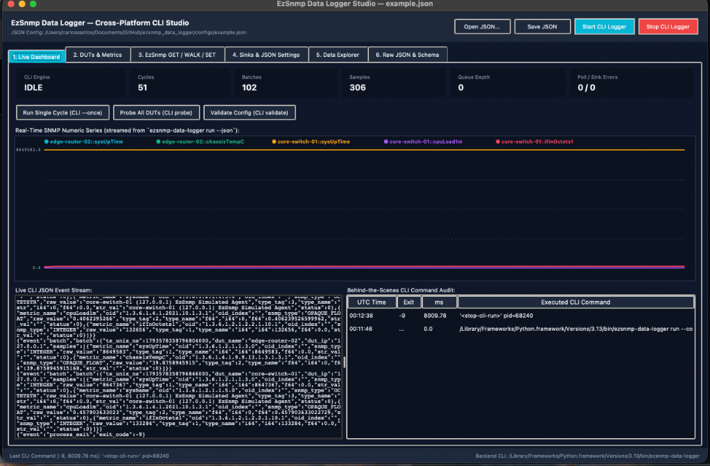

=============================
Cross-Platform GUI User Guide
=============================

``ezsnmp_data_logger`` provides a modern, responsive Graphical User Interface across **Linux, macOS, and Windows** that interacts **strictly with the CLI behind the scenes** via JSON payloads and child subprocesses.

.. contents:: Table of Contents
   :local:
   :depth: 2

Architecture: The Behind-the-Scenes CLI Bridge
==============================================

To guarantee that the GUI and CLI always produce 100% identical results and never diverge, the GUI contains **zero duplicated SNMP or storage logic**. 

Every user action in the interface (clicking a button, saving a setting, running a poll, probing a DUT) delegates to ``CliSubprocessBridge``. The bridge spawns ``ezsnmp-data-logger <subcommand> --json`` as a child process, parses the structured JSON response, and records the event in the **Behind-the-Scenes CLI Command Audit Trail**.

.. code-block:: text

   +-------------------------------------------------------------------------+
   |   GUI Frontend (Native Tkinter Desktop Studio or Browser Web Studio)    |
   +------------------------------------+------------------------------------+
                                        |
                         Executes: ezsnmp-data-logger <cmd> --json
                                        v
   +-------------------------------------------------------------------------+
   |   CliSubprocessBridge (Subprocess Execution & Audit Logger)             |
   |   - Captures: UTC Time | Subcommand | Exit Code | Latency (ms)          |
   |   - Streams: Live NDJSON event lines from `run --json`                  |
   +------------------------------------+------------------------------------+
                                        |
                                        v
   +-------------------------------------------------------------------------+
   |   C++17 Telemetry Engine (EzSnmpPoller -> BoundedQueue -> Sinks)        |
   +-------------------------------------------------------------------------+

Two Cross-Platform Frontends
============================

The GUI is configured in your JSON settings under ``"gui": { "frontend": "auto" | "tk" | "web" }`` (or via the ``--frontend`` command-line flag):

1. **Native Desktop Studio (**``tk``**):**
   - Built on Python's cross-platform standard-library ``tkinter.ttk`` (Linux X11/Wayland, macOS Aqua, Windows Win32).
   - Zero external GUI or WebKit dependencies required.
   - Features dark and light themes, real-time ``Canvas`` telemetry charts, interactive series checkbuttons, clickable canvas legends, and instant responsive layouts.

2. **Browser Web Studio (**``web``**):**
   - Built on Python's standard-library ``http.server.ThreadingHTTPServer`` + responsive HTML5/SVG/CSS.
   - Zero external web frameworks (no Flask, Django, or FastAPI required).
   - Ideal for headless servers, Docker containers, remote clouds, WSL2, or SSH port-forwarding.

Launching the GUI
=================

.. code-block:: bash

   # Auto-detect: launches native Desktop Tkinter Studio if a graphical display exists, else Web Studio
   ezsnmp-data-logger gui --config configs/example.json

   # Force Native Desktop Tkinter Studio
   ezsnmp-data-logger-gui --config configs/example.json --frontend tk

   # Force Browser Web Studio on specified port
   ezsnmp-data-logger-gui --config configs/example.json --frontend web --port 8765

   # Launch on a remote headless server bound to all network interfaces
   ezsnmp-data-logger-gui --config configs/example.json --frontend web --host 0.0.0.0 --port 8765 --no-browser

   # Launch in Spanish using the built-in 'es' catalog
   ezsnmp-data-logger-gui --config configs/example.json --locale es

   # Launch using a custom translation locale file
   ezsnmp-data-logger-gui --config configs/example.json --locale-file /path/to/my_locale.json

Detailed Tab-by-Tab Walkthrough
===============================

Tab 1: Live Dashboard
---------------------
The primary monitoring cockpit for real-time telemetry observation:

   EzSnmp Data Logger Studio — Live Dashboard monitoring real-time telemetry streaming from the CLI engine.

- **Telemetry KPI Grid:**
  - **CLI State:** Indicates whether the background CLI polling engine is ``IDLE`` or ``RUNNING``.
  - **Cycles:** Total number of completed polling cycles.
  - **Batches:** Number of batches successfully dispatched to sinks.
  - **Samples:** Total individual numeric SNMP telemetry data points ingested.
  - **Queue Depth:** Current count of batches in the thread-safe bounded buffer.
  - **Poll / Sink Errors:** Error counter (e.g. ``0 / 0``) tracking network timeouts or storage write failures.

- **One-Click Action Buttons:**
  - **Run Single Cycle (CLI ``--once``):** Spawns ``ezsnmp-data-logger run --once --json`` to execute a single cycle across all DUTs, persisting data immediately.
  - **Probe All DUTs (CLI ``probe``):** Tests reachability of all configured devices without writing to persistent sinks.
  - **Validate Config (CLI ``validate``):** Runs full schema and credential validation on the active JSON file.

- **Real-Time Telemetry Chart with Selectable Series:**
  - Renders live numeric SNMP telemetry streamed directly from child CLI process events.
  - **Select One or Many Series:** Use the checkbuttons (Desktop Tk) or filter chips/pills (Web Studio) above the chart to choose exactly which metrics to display.
  - **Automatic Y-Axis Rescaling:** When large-magnitude counters (e.g. ``sysUpTime`` ~8,600,000) are deselected, the Y-axis immediately rescales to lower-magnitude metrics (e.g. ``cpuLoad1m`` ~0.4, ``chassisTempC`` ~40°C), making subtle variations clearly visible.
  - **Select All & Clear All:** Quickly toggle visibility across all available metrics.
  - **Canvas Legend Interaction:** In Desktop Tkinter, clicking any legend entry directly on the chart canvas toggles its visibility.

- **Live CLI JSON Event Stream Console:**
  - Live console view displaying the exact NDJSON event lines streamed from the child ``ezsnmp-data-logger run --json`` engine process.

- **Behind-the-Scenes CLI Command Audit Trail:**
  - Live audit table tracking every action taken in the GUI with columns for **UTC Time**, **Exit Code**, **Duration (ms)**, and the exact **Executed CLI Command**.

Tab 2: DUTs & Metrics
---------------------
Inspect and configure network Devices Under Test (DUTs):

- **Device Parameters:** View and edit device names, IP addresses/hostnames, UDP ports (default 161), timeout intervals, and retry limits.
- **SNMP Version & Credentials:**
  - **SNMPv1 & SNMPv2c:** Community strings (e.g. ``public``).
  - **SNMPv3:** Security name, authentication protocol (``MD5`` or ``SHA``), authentication passphrases, privacy protocol (``DES`` or ``AES``), privacy keys, and security levels (``noAuthNoPriv``, ``authNoPriv``, ``authPriv``).
- **Metric Definitions:** Configure metric names, target OIDs, ASN.1 data types, and collection rates per device.

Tab 3: EzSnmp GET / WALK / SET Workbench
----------------------------------------
An interactive diagnostic laboratory to run ad-hoc SNMP operations against any configured device:

- **Operation Selector:** Choose between ``get``, ``getnext``, ``walk``, ``bulkget``, ``bulkwalk``, and ``set``.
- **Target OID Field:** Enter standard MIB OIDs or dotted numeric strings (e.g. ``1.3.6.1.2.1.1.1.0``).
- **Record Checkbox:** When checked, passes ``--record`` to the CLI, storing the returned samples directly into your configured persistence sinks.
- **Results Table:** Displays returned variable bindings including OID, OID index, ASN.1 type tag, human-readable type name, raw value, and status.

Tab 4: Sinks & JSON Settings
----------------------------
Configure telemetry persistence destinations and GUI preferences:

- **Storage Sinks:**
  - **SQLite3:** Embedded WAL-mode database path with automatic schema migrations.
  - **JSONL:** Newline-delimited JSON log file destination.
  - **CSV:** Comma-separated values log destination with timestamp headers.
  - **Prometheus Exporter:** Embedded HTTP exposition endpoint (e.g. ``0.0.0.0:9100/metrics``) with gauge and counter metrics.
  - **PostgreSQL / TimescaleDB:** Connection URI for hypertable time-series storage.
- **GUI Preferences:**
  - **Theme:** Switch between high-contrast **Dark** and clean **Light** themes.
  - **Refresh Interval:** Configure the polling state UI refresh rate (default 1000 ms).
  - **Language / Locale:** Switch UI language live via the locale dropdown.

Tab 5: Data Explorer
--------------------
Search and inspect historical telemetry rows without leaving the application:

- Query recent telemetry records directly from the embedded SQLite3 database.
- Filter by **Device Under Test (DUT)** and **Metric Name**.
- View timestamp (Unix nanoseconds and ISO-8601), device name, metric name, OID, SNMP data type, formatted value, and storage sink source.

Tab 6: Raw JSON & Schema Validator
----------------------------------
Advanced direct configuration editing:

- **Live Syntax Validation:** Validates JSON syntax in real time against the embedded C++ JSON schema validator.
- **Template Selector:** Load built-in starter templates (``demo``, ``minimal``, ``all_sinks``).
- **Save & Apply:** Saves changes directly to disk and reloads the engine state.

Custom Branding Icons & Desktop Application Launchers
=====================================================

``ezsnmp_data_logger`` includes a custom branding icon and favicon suite, ensuring neither Desktop Studio nor Web Studio display generic Python or browser tab icons:

- **Browser Web Studio Favicons:** Vector SVG (``favicon.svg``), Windows ICO (``favicon.ico``), multi-resolution PNGs (``favicon-32x32.png``, ``favicon-16x16.png``), and Apple Touch Icon (``apple-touch-icon.png``).
- **Desktop Tkinter Window & Dock Icon:** Custom window titlebar icon (``app_icon.png`` / ``app_icon.ico``) and automatic macOS Dock icon configuration via standard Cocoa/AppKit integration (zero extra dependencies).
- **Desktop Application Launcher Installer:** Install a native launcher with custom icons for your operating system:

.. code-block:: bash

   # Install native launcher (~/Applications on macOS, ~/.local/share/applications on Linux)
   ezsnmp-data-logger-gui --install-launcher

   # Or specify a custom destination directory (e.g. ~/Desktop)
   ezsnmp-data-logger-gui --install-launcher --launcher-dir ~/Desktop

Multi-Language Localization (``locale.json``)
=============================================

All user-facing UI strings (titles, buttons, status bars, tabs, KPI cards, table headers, form labels, and dialog messages) across both Desktop Studio and Web Studio are externalized into ``ezsnmp_data_logger/gui/locale.json``.

Each key is mapped to an object containing language translations:

.. code-block:: json

   {
     "buttons.start_logger": {
       "en": "Start CLI Logger",
       "es": "Iniciar Logger CLI"
     },
     "buttons.stop_logger": {
       "en": "Stop CLI Logger"
     },
     "labels.visible_series": {
       "en": "Visible Series:"
     },
     "buttons.select_all": {
       "en": "Select All"
     },
     "buttons.clear_all": {
       "en": "Clear All"
     }
   }

- **Baseline Language:** Standardizes on English (``"en"``) as the primary baseline language for all keys. Additional language translations (e.g. ``"es"``, ``"fr"``) can be added per key as needed.
- **Persistent Configuration:** Configure your preferred language directly in the JSON configuration under ``"gui": { "locale": "en" }`` (or ``"locale_file": "path/to/custom.json"``).
- **Desktop Studio Switching:** Switch between languages live via the combobox in Tab 4 (Sinks & JSON Settings).
- **Browser Studio Switching:** Switch languages instantly from the language dropdown in the top navigation toolbar.
- **Graceful Fallback:** Any key or translation not defined in a custom language file automatically falls back to the canonical English string.
